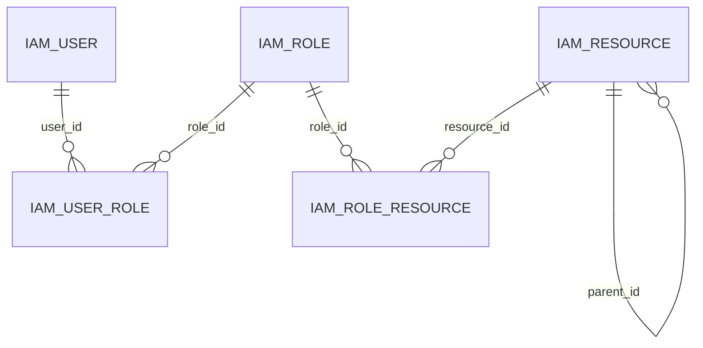

# 03 数据库设计

> 状态：v0.3（评审确认定稿）
> 更新：2026-11-12
> 关联：`01-需求与功能模块梳理.md`、`02-技术选型与整体架构.md`、`04-API接口设计.md`、`../rules/database-rules.md`、`06-设计方案评审结果.md`
> 参考 DDL：`../../scripts/sql/schema.sql`

## 1. 设计范围与依据

本文件描述 Keel 后端的物理数据库设计：

- 数据库：MySQL 8.x，InnoDB，`utf8mb4` / `utf8mb4_0900_ai_ci`。
- 表归属：`keel-iam`、`keel-system`、`keel-audit` 三个业务模块。
- 所有表使用自增 `BIGINT` 主键。
- **禁止物理外键**；表之间通过逻辑关联字段建立关系，应用层负责引用校验与清理。
- 业务唯一值使用唯一约束。
- 不做全局逻辑删除。
- 时区采用 `Asia/Shanghai` 本地时间，已在 `../rules/database-rules.md` 与 `02` 中记录为例外。

## 2. 逻辑模型



> 以上为逻辑关系，数据库不创建 `FOREIGN KEY`。

- 用户与角色：多对多。
- 角色与资源：多对多。
- 资源自关联：目录 / 菜单树。
- 系统参数、操作日志、登录日志为独立表，不与业务表建立物理关联。

## 3. 表清单

| 表名 | 所属模块 | 类型 | 审计字段 | version | 说明 |
|---|---|---|---|---|---|
| `iam_user` | iam | 可变 | 完整 | 有 | 管理员账号 |
| `iam_role` | iam | 可变 | 完整 | 有 | 角色 |
| `iam_resource` | iam | 可变 | 完整 | 有 | 目录 / 菜单 / 按钮 / 接口资源 |
| `iam_user_role` | iam | 关联 | `created_*` | 无 | 用户-角色 |
| `iam_role_resource` | iam | 关联 | `created_*` | 无 | 角色-资源 |
| `sys_config` | system | 可变 | 完整 | 有 | 系统参数 |
| `aud_operation_log` | audit | 追加 | `created_at` | 无 | 操作日志 |
| `aud_login_log` | audit | 追加 | `created_at` | 无 | 登录日志 |

## 4. 公共字段与约定

### 4.1 主键与关联

- 主键统一 `id BIGINT NOT NULL AUTO_INCREMENT`。
- 逻辑关联列使用 `{实体}_id`，如 `user_id`、`role_id`、`resource_id`；资源树父级使用 `parent_id`。
- 不创建物理外键；引用校验见第 7 节。

### 4.2 审计字段

可变业务表包含：

```sql
created_at DATETIME(3) NOT NULL COMMENT '创建时间',
created_by BIGINT NOT NULL DEFAULT 0 COMMENT '创建人ID，0=系统',
updated_at DATETIME(3) NOT NULL COMMENT '更新时间',
updated_by BIGINT NOT NULL DEFAULT 0 COMMENT '更新人ID，0=系统'
```

- 追加型日志表只有 `created_at`。
- 审计字段由 `MetaObjectHandler` 填充，禁止在业务代码手工赋值。

### 4.3 状态、布尔与枚举

- 状态统一 `VARCHAR(16)`，取值为 `ENABLED` / `DISABLED`。
- 布尔统一 `TINYINT(1) NOT NULL DEFAULT 0`，命名不使用 `is_` 前缀。
- 枚举统一 `VARCHAR(32)` 字符串编码，不使用数据库 `ENUM`。
- 类型字段：`DIRECTORY` / `MENU` / `BUTTON` / `API`。
- 操作日志动作：`CREATE`、`UPDATE`、`DELETE`、`STATUS_CHANGE`、`ASSIGN`；登录日志动作：`LOGIN`、`LOGOUT`、`LOGIN_FAILED`。

### 4.4 时间与长度

- 时间统一 `DATETIME(3)`，禁止 `TIMESTAMP`。
- 常用长度：`username` 64、角色 `code` 64、资源 `code` 128、`path` 255、`component` 255、`trace_id` 64、IP 64、User-Agent 512、URI 512。
- 大文本使用 `TEXT`：`sys_config.config_value`、`aud_operation_log.request_params`。

## 5. 表结构

### 5.1 `iam_user`

```sql
CREATE TABLE iam_user (
  id BIGINT NOT NULL AUTO_INCREMENT COMMENT '主键',
  username VARCHAR(64) NOT NULL COMMENT '登录名',
  password_hash VARCHAR(100) NOT NULL COMMENT 'BCrypt 密码哈希',
  nickname VARCHAR(64) NOT NULL DEFAULT '' COMMENT '昵称',
  email VARCHAR(128) NULL COMMENT '邮箱，可为空',
  phone VARCHAR(32) NULL COMMENT '手机号，可为空',
  status VARCHAR(16) NOT NULL DEFAULT 'ENABLED' COMMENT '状态：ENABLED/DISABLED',
  must_change_password TINYINT(1) NOT NULL DEFAULT 0 COMMENT '是否必须修改密码：0否1是',
  last_login_at DATETIME(3) NULL COMMENT '最近登录时间',
  last_login_ip VARCHAR(64) NULL COMMENT '最近登录IP',
  created_at DATETIME(3) NOT NULL COMMENT '创建时间',
  created_by BIGINT NOT NULL DEFAULT 0 COMMENT '创建人ID，0=系统',
  updated_at DATETIME(3) NOT NULL COMMENT '更新时间',
  updated_by BIGINT NOT NULL DEFAULT 0 COMMENT '更新人ID，0=系统',
  version INT NOT NULL DEFAULT 0 COMMENT '乐观锁版本',
  PRIMARY KEY (id),
  UNIQUE KEY uk_iam_user_username (username),
  KEY idx_iam_user_status_created_at (status, created_at)
) ENGINE=InnoDB DEFAULT CHARSET=utf8mb4 COLLATE=utf8mb4_0900_ai_ci COMMENT='IAM 用户';
```

说明：

- `username` 唯一，作为登录标识；本期不允许修改。
- `email` / `phone` 仅作资料字段，不参与登录，可为空。
- 用户不物理删除，只通过 `status` 禁用；禁用时同时吊销全部 token。
- 管理员重置密码时设置 `must_change_password = 1`。

### 5.2 `iam_role`

```sql
CREATE TABLE iam_role (
  id BIGINT NOT NULL AUTO_INCREMENT COMMENT '主键',
  code VARCHAR(64) NOT NULL COMMENT '角色编码，稳定标识',
  name VARCHAR(64) NOT NULL COMMENT '角色名称',
  description VARCHAR(255) NULL COMMENT '描述',
  status VARCHAR(16) NOT NULL DEFAULT 'ENABLED' COMMENT '状态：ENABLED/DISABLED',
  sort INT NOT NULL DEFAULT 0 COMMENT '排序',
  created_at DATETIME(3) NOT NULL COMMENT '创建时间',
  created_by BIGINT NOT NULL DEFAULT 0 COMMENT '创建人ID，0=系统',
  updated_at DATETIME(3) NOT NULL COMMENT '更新时间',
  updated_by BIGINT NOT NULL DEFAULT 0 COMMENT '更新人ID，0=系统',
  version INT NOT NULL DEFAULT 0 COMMENT '乐观锁版本',
  PRIMARY KEY (id),
  UNIQUE KEY uk_iam_role_code (code),
  KEY idx_iam_role_status_sort (status, sort)
) ENGINE=InnoDB DEFAULT CHARSET=utf8mb4 COLLATE=utf8mb4_0900_ai_ci COMMENT='IAM 角色';
```

说明：

- `code` 是稳定标识，`SUPER_ADMIN` 受保护，不可删除、不可修改 code、不可禁用。
- 角色被用户引用时禁止删除；应用服务在删除时清理 `iam_role_resource`。

### 5.3 `iam_resource`

```sql
CREATE TABLE iam_resource (
  id BIGINT NOT NULL AUTO_INCREMENT COMMENT '主键',
  parent_id BIGINT NOT NULL DEFAULT 0 COMMENT '父资源ID，0=根',
  type VARCHAR(16) NOT NULL COMMENT '类型：DIRECTORY/MENU/BUTTON/API',
  code VARCHAR(128) NOT NULL COMMENT '资源编码；目录仅作稳定标识，菜单/按钮/接口用于鉴权',
  name VARCHAR(64) NOT NULL COMMENT '资源名称',
  path VARCHAR(255) NULL COMMENT '前端路径，目录/菜单使用',
  component VARCHAR(255) NULL COMMENT '前端组件，菜单使用',
  icon VARCHAR(64) NULL COMMENT '图标名',
  sort INT NOT NULL DEFAULT 0 COMMENT '排序',
  visible TINYINT(1) NOT NULL DEFAULT 1 COMMENT '是否显示：0否1是',
  status VARCHAR(16) NOT NULL DEFAULT 'ENABLED' COMMENT '状态：ENABLED/DISABLED',
  created_at DATETIME(3) NOT NULL COMMENT '创建时间',
  created_by BIGINT NOT NULL DEFAULT 0 COMMENT '创建人ID，0=系统',
  updated_at DATETIME(3) NOT NULL COMMENT '更新时间',
  updated_by BIGINT NOT NULL DEFAULT 0 COMMENT '更新人ID，0=系统',
  version INT NOT NULL DEFAULT 0 COMMENT '乐观锁版本',
  PRIMARY KEY (id),
  UNIQUE KEY uk_iam_resource_code (code),
  UNIQUE KEY uk_iam_resource_path (path),
  KEY idx_iam_resource_parent_id (parent_id),
  KEY idx_iam_resource_type_status_sort (type, status, sort)
) ENGINE=InnoDB DEFAULT CHARSET=utf8mb4 COLLATE=utf8mb4_0900_ai_ci COMMENT='IAM 资源';
```

说明：

- 目录、菜单、按钮、接口统一存储；`type` 区分。
- `API` 为预留类型；本期接口鉴权复用菜单/按钮权限码，不单独种子化 API 资源。
- 目录的 `code` 只作为稳定标识（如 `iam:directory`），不用于接口鉴权。
- 菜单 / 按钮 / 接口的 `code` 是权限码，格式 `模块:资源:动作`。
- `path` 唯一；按钮与接口的 `path` 为 `NULL`，MySQL 唯一索引允许多个 `NULL`。
- 系统资源的 `type` / `code` / `path` / `component` 由 Flyway 维护，后台只改展示属性。

### 5.4 `iam_user_role`

```sql
CREATE TABLE iam_user_role (
  id BIGINT NOT NULL AUTO_INCREMENT COMMENT '主键',
  user_id BIGINT NOT NULL COMMENT '用户ID',
  role_id BIGINT NOT NULL COMMENT '角色ID',
  created_at DATETIME(3) NOT NULL COMMENT '创建时间',
  created_by BIGINT NOT NULL DEFAULT 0 COMMENT '创建人ID，0=系统',
  PRIMARY KEY (id),
  UNIQUE KEY uk_iam_user_role_user_id_role_id (user_id, role_id),
  KEY idx_iam_user_role_role_id (role_id)
) ENGINE=InnoDB DEFAULT CHARSET=utf8mb4 COLLATE=utf8mb4_0900_ai_ci COMMENT='IAM 用户角色关联';
```

### 5.5 `iam_role_resource`

```sql
CREATE TABLE iam_role_resource (
  id BIGINT NOT NULL AUTO_INCREMENT COMMENT '主键',
  role_id BIGINT NOT NULL COMMENT '角色ID',
  resource_id BIGINT NOT NULL COMMENT '资源ID',
  created_at DATETIME(3) NOT NULL COMMENT '创建时间',
  created_by BIGINT NOT NULL DEFAULT 0 COMMENT '创建人ID，0=系统',
  PRIMARY KEY (id),
  UNIQUE KEY uk_iam_role_resource_role_id_resource_id (role_id, resource_id),
  KEY idx_iam_role_resource_resource_id (resource_id)
) ENGINE=InnoDB DEFAULT CHARSET=utf8mb4 COLLATE=utf8mb4_0900_ai_ci COMMENT='IAM 角色资源关联';
```

### 5.6 `sys_config`

```sql
CREATE TABLE sys_config (
  id BIGINT NOT NULL AUTO_INCREMENT COMMENT '主键',
  config_key VARCHAR(128) NOT NULL COMMENT '参数键',
  config_value TEXT NOT NULL COMMENT '参数值',
  config_group VARCHAR(64) NOT NULL DEFAULT 'DEFAULT' COMMENT '参数分组',
  public_flag TINYINT(1) NOT NULL DEFAULT 0 COMMENT '是否公开：0否1是',
  description VARCHAR(255) NULL COMMENT '说明',
  created_at DATETIME(3) NOT NULL COMMENT '创建时间',
  created_by BIGINT NOT NULL DEFAULT 0 COMMENT '创建人ID，0=系统',
  updated_at DATETIME(3) NOT NULL COMMENT '更新时间',
  updated_by BIGINT NOT NULL DEFAULT 0 COMMENT '更新人ID，0=系统',
  version INT NOT NULL DEFAULT 0 COMMENT '乐观锁版本',
  PRIMARY KEY (id),
  UNIQUE KEY uk_sys_config_key (config_key),
  KEY idx_sys_config_group_config_key (config_group, config_key)
) ENGINE=InnoDB DEFAULT CHARSET=utf8mb4 COLLATE=utf8mb4_0900_ai_ci COMMENT='系统参数';
```

说明：

- `config_key` 唯一且稳定。
- `public_flag = 1` 的参数可通过公开接口读取；敏感参数必须为 0。
- 参数值以字符串存储；应用层负责类型转换与校验。

### 5.7 `aud_operation_log`

```sql
CREATE TABLE aud_operation_log (
  id BIGINT NOT NULL AUTO_INCREMENT COMMENT '主键',
  trace_id VARCHAR(64) NULL COMMENT '请求链路标识',
  user_id BIGINT NULL COMMENT '操作人ID，系统任务为空',
  username VARCHAR(64) NULL COMMENT '操作人用户名',
  module VARCHAR(32) NOT NULL COMMENT '模块编码',
  action VARCHAR(32) NOT NULL COMMENT '动作编码',
  method VARCHAR(255) NULL COMMENT '类名#方法名',
  request_method VARCHAR(8) NULL COMMENT 'HTTP 方法',
  request_uri VARCHAR(512) NULL COMMENT '请求 URI',
  request_params TEXT NULL COMMENT '脱敏并截断后的请求参数',
  success TINYINT(1) NOT NULL DEFAULT 0 COMMENT '是否成功：0否1是',
  error_message VARCHAR(1024) NULL COMMENT '错误信息',
  ip VARCHAR(64) NULL COMMENT '来源IP',
  user_agent VARCHAR(512) NULL COMMENT 'User-Agent',
  duration_ms INT NULL COMMENT '耗时毫秒',
  created_at DATETIME(3) NOT NULL COMMENT '创建时间',
  PRIMARY KEY (id),
  KEY idx_aud_operation_log_created_at (created_at),
  KEY idx_aud_operation_log_user_id_created_at (user_id, created_at),
  KEY idx_aud_operation_log_username_created_at (username, created_at),
  KEY idx_aud_operation_log_module_action_created_at (module, action, created_at),
  KEY idx_aud_operation_log_trace_id (trace_id)
) ENGINE=InnoDB DEFAULT CHARSET=utf8mb4 COLLATE=utf8mb4_0900_ai_ci COMMENT='操作日志';
```

说明：

- 只追加，不更新、不删除。
- 不建物理外键，`user_id` 按值存储。
- `request_params` 由应用层脱敏并截断到 2 KB。

### 5.8 `aud_login_log`

```sql
CREATE TABLE aud_login_log (
  id BIGINT NOT NULL AUTO_INCREMENT COMMENT '主键',
  trace_id VARCHAR(64) NULL COMMENT '请求链路标识',
  user_id BIGINT NULL COMMENT '用户ID，未知用户为空',
  username VARCHAR(64) NOT NULL COMMENT '登录名',
  action VARCHAR(16) NOT NULL COMMENT '动作：LOGIN/LOGOUT/LOGIN_FAILED',
  login_type VARCHAR(16) NOT NULL DEFAULT 'ADMIN' COMMENT '账号体系：ADMIN/APP/MINI',
  device VARCHAR(16) NOT NULL DEFAULT 'WEB' COMMENT '终端：WEB/APP/MINI',
  ip VARCHAR(64) NULL COMMENT '来源IP',
  user_agent VARCHAR(512) NULL COMMENT 'User-Agent',
  success TINYINT(1) NOT NULL DEFAULT 0 COMMENT '是否成功：0否1是',
  failure_reason VARCHAR(64) NULL COMMENT '失败原因编码',
  created_at DATETIME(3) NOT NULL COMMENT '创建时间',
  PRIMARY KEY (id),
  KEY idx_aud_login_log_created_at (created_at),
  KEY idx_aud_login_log_username_created_at (username, created_at),
  KEY idx_aud_login_log_user_id_created_at (user_id, created_at)
) ENGINE=InnoDB DEFAULT CHARSET=utf8mb4 COLLATE=utf8mb4_0900_ai_ci COMMENT='登录日志';
```

说明：

- 登录失败原因编码：`BAD_CREDENTIALS`、`ACCOUNT_DISABLED`、`LOCKED`、`INVALID_REQUEST`。
- 登出记录 `action = LOGOUT`，`success = 1`。
- 只追加，不建物理外键。

## 6. 索引与查询

| 表 | 索引 | 列 | 用途 |
|---|---|---|---|
| `iam_user` | `uk_iam_user_username` | `username` | 登录、唯一性 |
| `iam_user` | `idx_iam_user_status_created_at` | `status, created_at` | 用户列表按状态筛选 |
| `iam_role` | `uk_iam_role_code` | `code` | 角色唯一标识 |
| `iam_role` | `idx_iam_role_status_sort` | `status, sort` | 角色列表 |
| `iam_resource` | `uk_iam_resource_code` | `code` | 权限码唯一 |
| `iam_resource` | `uk_iam_resource_path` | `path` | 菜单路径唯一 |
| `iam_resource` | `idx_iam_resource_parent_id` | `parent_id` | 资源树查询 |
| `iam_resource` | `idx_iam_resource_type_status_sort` | `type, status, sort` | 菜单树渲染 |
| `iam_user_role` | `uk_iam_user_role_user_id_role_id` | `user_id, role_id` | 关联唯一性、按用户查角色 |
| `iam_user_role` | `idx_iam_user_role_role_id` | `role_id` | 按角色查用户 |
| `iam_role_resource` | `uk_iam_role_resource_role_id_resource_id` | `role_id, resource_id` | 关联唯一性、按角色查资源 |
| `iam_role_resource` | `idx_iam_role_resource_resource_id` | `resource_id` | 按资源查角色 |
| `sys_config` | `uk_sys_config_key` | `config_key` | 参数唯一、按 key 查 |
| `sys_config` | `idx_sys_config_group_config_key` | `config_group, config_key` | 按分组筛选并按 key 排序/前缀查询 |
| `aud_operation_log` | `idx_aud_operation_log_created_at` | `created_at` | 时间范围查询、清理 |
| `aud_operation_log` | `idx_aud_operation_log_user_id_created_at` | `user_id, created_at` | 按用户查询 |
| `aud_operation_log` | `idx_aud_operation_log_username_created_at` | `username, created_at` | 按用户名查询 |
| `aud_operation_log` | `idx_aud_operation_log_module_action_created_at` | `module, action, created_at` | 按模块/动作筛选 |
| `aud_operation_log` | `idx_aud_operation_log_trace_id` | `trace_id` | 链路关联 |
| `aud_login_log` | `idx_aud_login_log_created_at` | `created_at` | 时间范围查询、清理 |
| `aud_login_log` | `idx_aud_login_log_username_created_at` | `username, created_at` | 按用户名查询 |
| `aud_login_log` | `idx_aud_login_log_user_id_created_at` | `user_id, created_at` | 按用户查询 |

索引原则：

- 等值条件在前，范围条件在后，排序列尽量利用索引。
- 禁止为低基数列单独建索引；`success`、日志 `action` 等低选择性筛选不单独建索引，依赖时间范围索引与分页条件。
- 关联表除唯一组合索引外，为反向查询列建立索引。
- 上线前用 `EXPLAIN` 验证用户列表、角色授权、日志查询等核心 SQL。

## 7. 数据完整性与删除规则

### 7.1 应用层引用校验

由于禁止物理外键，以下校验必须在应用服务中完成，并与数据库唯一约束共同生效：

| 操作 | 校验 | 数据库防线 |
|---|---|---|
| 创建用户 | 用户名非空、格式合法、不存在 | `uk_iam_user_username` |
| 分配角色 | 用户存在、角色存在且启用 | `uk_iam_user_role_user_id_role_id` |
| 分配资源 | 角色存在、资源存在 | `uk_iam_role_resource_role_id_resource_id` |
| 删除角色 | 无用户引用；清理角色-资源 | 唯一约束 + 事务 |
| 删除资源 | 无子资源、无角色引用；仅通过迁移执行 | 迁移评审 + 唯一约束 |
| 修改资源父级 | 父级存在且为 `DIRECTORY` / `MENU`；`BUTTON` / `API` 父级非 0；不能形成环 | 应用层校验 |
| 停用目录/菜单 | 不存在启用子资源 | 应用层校验 |
| 禁用用户 | 更新状态并吊销 token | 事务 + 缓存失效 |
| 启用/禁用角色/资源 | 更新状态并清理受影响权限缓存 | 事务 + 缓存失效 |

### 7.2 删除规则

- **用户**：不物理删除，只禁用；禁用时删除 Redis 中全部 token，清理权限缓存。
- **角色**：存在 `iam_user_role` 引用时禁止删除；删除时在同一事务内清理 `iam_role_resource`。
- **资源**：存在子资源或 `iam_role_resource` 引用时禁止删除；后台不提供删除接口，删除仅通过 Flyway 迁移执行。
- **系统参数**：后台不提供删除接口，硬删除仅通过 Flyway 迁移或运维执行。
- **日志**：只追加，按保留期清理。

> 资源与系统参数不提供后台创建/删除接口，统一由 Flyway 迁移维护；管理端只更新展示属性或参数值。

### 7.3 事务边界

- 用户 + 用户角色、角色 + 角色资源等多表写入必须在同一应用服务事务内完成。
- 禁止在 Controller 中直接操作多个 Mapper。
- 事务失败必须回滚，不留下孤立关联。

### 7.4 孤立数据

- 无物理外键意味着可能产生孤立关联；通过应用层校验、唯一约束与集成测试防止。
- 可选：提供只读的完整性检查 SQL，定期检查 `iam_user_role`、`iam_role_resource` 的孤立行；不作为本期必做项。

## 8. Flyway 迁移计划

### 8.1 位置与命名

```properties
spring.flyway.locations=classpath:db/migration/iam,classpath:db/migration/system,classpath:db/migration/audit,classpath:db/migration/seed
```

- 模块脚本：`src/main/resources/db/migration/{module}`。
- 全局种子：`keel-bootstrap` 的 `db/migration/seed`。
- 文件名：`V{四位版本}__{module}_{描述}.sql`，描述使用小写 snake_case。
- 参考结构基线：`../../scripts/sql/schema.sql`，仅用于评审与对照，实际执行以 Flyway 为准；结构变更时必须同步更新该文件。

### 8.2 迁移清单

| 版本 | 文件 | 内容 |
|---|---|---|
| V1001 | `V1001__iam_create_user.sql` | `iam_user` |
| V1002 | `V1002__iam_create_role.sql` | `iam_role` |
| V1003 | `V1003__iam_create_resource.sql` | `iam_resource` |
| V1004 | `V1004__iam_create_user_role.sql` | `iam_user_role` |
| V1005 | `V1005__iam_create_role_resource.sql` | `iam_role_resource` |
| V2001 | `V2001__system_create_config.sql` | `sys_config` |
| V3001 | `V3001__audit_create_operation_log.sql` | `aud_operation_log` |
| V3002 | `V3002__audit_create_login_log.sql` | `aud_login_log` |
| V9001 | `V9001__seed_super_admin_role.sql` | `SUPER_ADMIN` 角色 |
| V9002 | `V9002__seed_core_resources.sql` | 核心资源树 |
| V9003 | `V9003__seed_core_config.sql` | 核心系统参数 |

- 迁移只前进，不修改已执行脚本。
- 种子数据按业务 `code` 幂等插入，不依赖固定自增 ID。
- 所有迁移在 Testcontainers 的 MySQL 8 上验证。

## 9. 初始化数据

### 9.1 `SUPER_ADMIN` 角色

```sql
INSERT INTO iam_role (code, name, description, status, sort, created_at, created_by, updated_at, updated_by, version)
SELECT 'SUPER_ADMIN', '超级管理员', '内置超级管理员角色', 'ENABLED', 0, NOW(3), 0, NOW(3), 0, 0
WHERE NOT EXISTS (SELECT 1 FROM iam_role WHERE code = 'SUPER_ADMIN');
```

- `SUPER_ADMIN` 不绑定资源；鉴权时直接绕过权限校验。
- `/me` 对超级管理员返回全部启用菜单。

### 9.2 核心资源

| code | type | parent | name | path | component | icon | sort | visible |
|---|---|---|---|---|---|---|---|---|
| `iam:directory` | DIRECTORY | 0 | 身份与权限 | `/iam` | NULL | `shield` | 20 | 1 |
| `iam:user:list` | MENU | `iam:directory` | 用户管理 | `/iam/users` | `iam/users/index` | `users` | 201 | 1 |
| `iam:user:create` | BUTTON | `iam:user:list` | 新增用户 | NULL | NULL | NULL | 20101 | 0 |
| `iam:user:update` | BUTTON | `iam:user:list` | 编辑用户 | NULL | NULL | NULL | 20102 | 0 |
| `iam:user:status` | BUTTON | `iam:user:list` | 启用/禁用用户 | NULL | NULL | NULL | 20103 | 0 |
| `iam:user:reset-password` | BUTTON | `iam:user:list` | 重置密码 | NULL | NULL | NULL | 20104 | 0 |
| `iam:user:assign-role` | BUTTON | `iam:user:list` | 分配角色 | NULL | NULL | NULL | 20105 | 0 |
| `iam:user:force-logout` | BUTTON | `iam:user:list` | 强制下线 | NULL | NULL | NULL | 20106 | 0 |
| `iam:role:list` | MENU | `iam:directory` | 角色管理 | `/iam/roles` | `iam/roles/index` | `key-round` | 202 | 1 |
| `iam:role:create` | BUTTON | `iam:role:list` | 新增角色 | NULL | NULL | NULL | 20201 | 0 |
| `iam:role:update` | BUTTON | `iam:role:list` | 编辑角色 | NULL | NULL | NULL | 20202 | 0 |
| `iam:role:delete` | BUTTON | `iam:role:list` | 删除角色 | NULL | NULL | NULL | 20203 | 0 |
| `iam:role:assign-resource` | BUTTON | `iam:role:list` | 分配资源 | NULL | NULL | NULL | 20204 | 0 |
| `iam:resource:list` | MENU | `iam:directory` | 资源管理 | `/iam/resources` | `iam/resources/index` | `menu` | 203 | 1 |
| `iam:resource:update` | BUTTON | `iam:resource:list` | 编辑资源 | NULL | NULL | NULL | 20301 | 0 |
| `iam:resource:status` | BUTTON | `iam:resource:list` | 启用/禁用资源 | NULL | NULL | NULL | 20302 | 0 |
| `sys:directory` | DIRECTORY | 0 | 系统设置 | `/system` | NULL | `settings` | 30 | 1 |
| `sys:config:list` | MENU | `sys:directory` | 系统参数 | `/system/config` | `system/config/index` | `sliders-horizontal` | 301 | 1 |
| `sys:config:update` | BUTTON | `sys:config:list` | 修改参数 | NULL | NULL | NULL | 30101 | 0 |
| `audit:directory` | DIRECTORY | 0 | 审计日志 | `/audit` | NULL | `file-clock` | 40 | 1 |
| `audit:operation:list` | MENU | `audit:directory` | 操作日志 | `/audit/operation-logs` | `audit/operation-logs/index` | `scroll-text` | 401 | 1 |
| `audit:login:list` | MENU | `audit:directory` | 登录日志 | `/audit/login-logs` | `audit/login-logs/index` | `log-in` | 402 | 1 |

- 每个资源都有稳定的 `code`；目录的 `code` 只用于种子引用，不用于接口鉴权。
- 按钮的 `visible = 0`，不进入侧边栏。
- 资源通过 `parent_id` 组成逻辑树，不使用物理外键。
- 种子 SQL 使用 `INSERT ... SELECT ... WHERE NOT EXISTS`，并按父级 `code` 查询 `parent_id`。
- 本期不提供仪表盘菜单；Admin 登录后跳转第一个有权限的菜单。
- `API` 为预留资源类型，本期不种子化；接口鉴权复用 `MENU` / `BUTTON` 的权限码。

### 9.3 核心系统参数

| config_key | 默认值 | 分组 | public_flag | 说明 |
|---|---|---|---|---|
| `system.name` | `Keel` | SYSTEM | 1 | 系统名称 |
| `system.logo-url` | 空字符串 | SYSTEM | 1 | 系统 Logo 地址 |
| `auth.web.idle-timeout-minutes` | `30` | AUTH | 0 | Web 空闲超时（分钟） |
| `auth.web.absolute-timeout-hours` | `12` | AUTH | 0 | Web 绝对超时（小时） |
| `auth.app.idle-timeout-days` | `7` | AUTH | 0 | App 空闲超时（天） |
| `auth.app.absolute-timeout-days` | `30` | AUTH | 0 | App 绝对超时（天） |
| `auth.max-login-failures` | `5` | AUTH | 0 | 连续登录失败上限 |
| `auth.lock-minutes` | `15` | AUTH | 0 | 登录锁定时长（分钟） |
| `audit.operation.retention-days` | `180` | AUDIT | 0 | 操作日志保留天数 |
| `audit.login.retention-days` | `365` | AUDIT | 0 | 登录日志保留天数 |

- 公开接口只返回 `public_flag = 1` 的参数。
- 参数修改写入操作日志。

### 9.4 初始管理员

- 不使用 SQL 预置管理员密码。
- 启动器在 Flyway 完成后检查管理员是否存在；不存在时根据 `KEEL_ADMIN_USERNAME` / `KEEL_ADMIN_PASSWORD` 创建。
- 绑定 `SUPER_ADMIN` 角色，设置 `must_change_password = 1`。
- 生产环境缺少密码时启动失败；开发环境可生成随机密码并只打印一次。

## 10. 容量、保留与清理

- 操作日志保留 180 天，登录日志保留 365 天，可通过系统参数调整。
- 每日 02:00 分批删除，每批 1000 条，避免长事务。
- 初期不分区；日志达到千万级后再评估按月分区或归档。
- `request_params` 应用层截断到 2 KB；`error_message` 限制 1024 字符。
- 用户、角色、资源、系统参数表数据量小，按主键与唯一索引查询即可。

## 11. 风险与应对

| 风险 | 说明 | 应对 |
|---|---|---|
| 无物理外键 | 可能产生孤立关联 | 应用层校验 + 唯一约束 + 集成测试；可选完整性检查 SQL |
| 本地时区 | 多地域迁移成本高 | 三处时区一致；文档记录例外；未来迁移 UTC |
| 种子 code 变更 | 会破坏角色授权与前端路由 | `code` 视为不可变；新增资源用新 code + 新迁移 |
| Flyway 多 jar 扫描 | 资源可能未加载 | 显式配置 locations，Phase 1A 验证 |
| 硬删除 | 不可恢复 | 删除前校验引用；通过 Flyway 迁移执行并保留迁移记录 |
| 自增 ID 可枚举 | 公开接口暴露数据量 | 管理端接受；公开 API 使用外部标识 |
| 日志表增长 | 影响查询与存储 | 保留期 + 分批清理；必要时分区 |

## 12. 评审清单

- [ ] 表名、列名、索引名符合 `../rules/database-rules.md`。
- [ ] 所有表和字段有注释。
- [ ] 主键自增、唯一、非空。
- [ ] 逻辑关联列有索引；无物理外键。
- [ ] 业务唯一值有唯一约束。
- [ ] 必填字段 `NOT NULL`，默认值有意义。
- [ ] 时间 `DATETIME(3)`；布尔 `TINYINT(1)`；枚举字符串编码。
- [ ] 审计字段齐全；日志表无 `updated_*`。
- [ ] 无逻辑删除列。
- [ ] 迁移版本段、文件命名、幂等种子符合约定。
- [ ] `scripts/sql/schema.sql` 与本文表结构、索引保持一致。
- [ ] 核心查询通过 `EXPLAIN`。
- [ ] 时区三处一致。

## 13. 关联文档

- `01-需求与功能模块梳理.md`
- `02-技术选型与整体架构.md`
- `04-API接口设计.md`
- `05-实施计划与工程规范.md`
- `06-设计方案评审结果.md`
- `../../scripts/sql/schema.sql`
- `../rules/database-rules.md`
