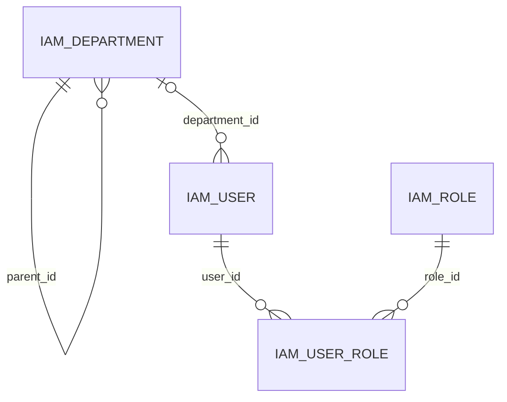

# 07 部门管理与用户页面调整设计

> 状态：v1.0（功能实现与定向验证完成；2026-11-16本地联调已升级，未部署生产环境）
> 日期：2026-11-15
> 依据：用户确认增加部门功能与页面、不增加岗位；先设计表和 API，确认后开发。
> 确认记录：用户确认方案后继续开发，并单独允许 OpenAPI 导出、Docker/Testcontainers 定向测试及前端测试；未授权部署或变更正在使用的数据库。
> 关联：01 需求、02 架构、03 数据库、04 API、05 实施计划、06 评审记录及 `docs/rules/`。

## 1. 范围与确认门

已确认：增加部门管理页面、部门表及接口；用户关联部门；用户页按参考图增加部门树和部门列；不增加岗位；新版新增用户表单必选部门，历史用户暂显示“未分配部门”，编辑时补齐。

后续讨论已确认：IAM 现有架构先不调整，本次不新增模块；部门放在 `keel-iam` 的 `organization` 子域，允许未来人员档案等业务复用。账号与人员档案分别建模，不把未来人事字段持续堆入用户表；组织信息由一个维护入口负责。随后用户以“继续”确认 v0.2 完整方案，进入实现。

本次一并确认的设计：

1. 部门为单棵组织树，一个用户至多归属一个部门；内置根部门 `ROOT` 默认显示“总公司”，允许改名，不允许移动、停用或删除。
2. 角色选填、多选、不默认勾选；不分配角色不产生角色授予的业务权限，仍保留现有登录与基础工作台能力。
3. 部门停用仅限制组织维护和新关联，不自动禁用用户、吊销登录或改变 RBAC；停用前必须先停用全部启用下级。
4. 保持 v1 兼容：旧创建接口新增可选部门参数；新版页面必选。新增完整资料接口保证资料与部门一次保存，旧编辑接口保持原语义。
5. 采用第 8 节的受控增量升级方案；不重置数据库，不修改已执行迁移。

排除：岗位、多部门任职、部门数据权限、部门继承角色、负责人/联系电话等扩展组织资料、导入导出、看板、批量用户操作、用户物理删除。

确认范围包含页面、表结构、接口、权限、迁移方案和验收要求；后续实质变更仍需按仓库流程确认。

## 2. 业务规则

### 2.1 部门树

- 根节点由迁移按 `code = ROOT` 幂等创建，不依赖固定自增 ID；其 `parent_id = 0`，深度为 1。
- 普通部门必须选择真实父部门，不接受 `parentId = 0`。不创建虚拟部门记录充当“全部部门”或“未分配部门”。
- 普通部门字段：部门编码、部门名称、上级部门、排序、状态。编码全局唯一、创建后不可改；名称允许跨部门重复，通过完整路径区分。
- 编码 2–64 位，`[A-Z][A-Z0-9_-]{1,63}`，输入先去首尾空格；`ROOT` 为保留值。名称去首尾空格后 1–64 字符；排序 0–9999。
- 同级名称唯一，数据库以 `(parent_id, name)` 唯一索引兜底；按项目排序规则比较，不另行引入大小写敏感规则。
- 同级按 `sort ASC, id ASC` 稳定排序。最多 1000 个节点（含根）、最多 16 层；创建或移动后整个子树均须满足深度限制。
- 创建、启用或移动到新父级时，目标父级及全部祖先必须存在且启用；不能选择自己或自己的后代为父级。
- 普通部门允许改名、排序、移动、启停。停用前若有任意启用后代，返回冲突，不自动级联；停用的部门仍保留在管理树与历史用户展示中。
- 存在任意直接子部门（含停用）或任意关联用户（含禁用用户）时，禁止删除。空叶子可物理删除，删除前二次确认，操作记审计日志。
- 根仅允许改名和排序，始终启用；编码与父级不可更改。根不存在属于部署/数据完整性故障，不自动把其他节点当根继续写入。

### 2.2 用户部门与状态

- `iam_user.department_id` 可空，仅为逻辑关联；不设物理外键，不复制部门名称到用户表。
- 历史账号和旧客户端创建的账号可暂未分配；展示“未分配部门”，不自动将历史用户归入根或其他部门。
- 新版管理端新增、保存完整资料时必选部门；根可作为有效归属。编辑未分配账号时必须补齐部门。
- 新建关联或更换归属时，仅可选择自身及祖先全部启用的部门。原归属已停用且本次不变时，允许保存其他资料；提示当前部门已停用，允许迁到启用部门。
- 部门启停或移动不自动修改任何用户状态、角色、权限缓存或 token；部门筛选不是数据权限，不能用树节点限制替代服务端鉴权。
- 用户部门、资料、创建状态、初始角色相关写入在同一用户事务内完成；已有用户的角色、状态仍走原有独立操作及权限，不通过资料保存顺带修改。

### 2.3 查询

- 点击部门默认查询该部门及全部后代的用户，包含停用部门中的账号；`includeDescendants=false` 时只查直接归属。
- 用户列表可同时筛选关键字、用户状态和部门，条件之间为 AND。
- “全部部门”为前端虚拟筛选项，不传部门条件。用户管理页面移除“未分配部门”筛选入口；API 保留 `unassignedDepartment=true` 查询 `department_id IS NULL` 的兼容能力。
- 关键字匹配登录账号、显示名称或手机号的前缀，三个字段间为 OR。保留旧 `username` 参数的账号前缀语义；与新 `keyword` 同传时两组条件按 AND 合并。
- 部门树搜索仅过滤可见节点，保留命中项的祖先路径；搜索不改变已选部门及用户查询条件。切换部门/查询/重置时用户分页归 1。
- 查询中的 `departmentId` 不存在返回 404，不退化为“全部”。树刷新后选中节点被删除时，页面显式回到全部并提示。

## 3. 模块与持久化方案

- 部门归属 `keel-iam`，表前缀 `iam_`；不新增 Maven 模块或前后端依赖，不让 system 直接依赖 IAM。
- 用例位于 `iam.application.organization`，接口位于 `iam.interfaces.admin`，Mapper/PO/SQL 位于已有 `iam.infrastructure.persistence`。用户用例通过部门应用查询/校验契约协作，不从其他业务模块取 Mapper。
- 部门是组织归属，不实现 `DataScopeProvider`，不改 `/auth/me` 与 token 协议。
- 使用邻接表 `parent_id`；不存逗号祖先路径、不使用 JSON 存用户部门、不建立闭包表。树在单次有界查询后组装和遍历，不逐节点查询。
- 部门树读取最多 1001 行用于越界检测；超过 1000 返回明确错误，不截断成不完整树。写入同时限制容量。
- 用户列表先按筛选分页，再批量取本页部门与角色；分页总数以用户为准，不直接 JOIN 多角色后分页，避免重复用户、总数错误和 N+1。
- 姓名/手机号 OR 前缀查询未保证单一索引可覆盖；实施时对真实组合做 EXPLAIN，不为每个输入字段机械加索引。

### 3.1 事务与并发

- 所有部门结构/状态/删除写事务先按 `code = ROOT` 锁定根行（排他锁），再读取当前树、校验并写入。由同一数据库的根行序列化拓扑变更，避免并发互相移动形成环；不使用进程内锁替代。
- 用户新关联/更换归属的事务先获取同一根行共享锁，再校验并锁定目标部门，再写用户；与部门停用、删除互斥，防止校验后目标被删除或停用。
- 部门写操作需要的其他行按主键升序锁定；先根、后部门、后用户，统一锁顺序。用户创建无部门的旧链路不需要部门锁。
- 用户编辑须带用户 `version`；部门更新/状态/删除须带部门 `version`。根行仅充当共同锁入口时不递增版本；实际编辑根才递增。
- 部门已有用户不阻止停用，所以并发分配若先完成、随后部门停用，用户归属合法保留；先停用则后续新分配失败。
- 容量、同级重名、引用检查必须在锁内重读；唯一冲突映射为业务错误，失败整体回滚。数据库死锁/超时使用现有错误归一化，不无限重试或返回成功。
- 锁内用于防环、状态、容量和引用校验的查询使用当前读；不得复用获取根锁前的结果或旧事务快照。引用检查可锁定首个匹配用户/子部门记录，不依赖普通快照 COUNT 作为并发防线。
- 取舍：组织结构写入串行，适合本期有界后台组织树；用户共享根锁可以并行。并发行为列为必须验证项。

### 3.2 面向人员档案等业务的复用边界（方向已确认）

- 组织子域是部门信息的唯一维护方；其他业务按稳定 departmentId 引用，不复制一套可独立编辑的部门主数据，不直接访问部门 Mapper。
- 账号 ID 与未来人员 ID 不合并。人员可以暂不拥有登录账号，系统账号也不强制关联人员；具体关联基数、入离职与任职历史在人员档案立项时设计。本次不预建人员表、personId 或岗位字段。
- IAM 内的 identity 使用 organization 应用层查询/校验入口；组织子域不以登录接口、账号表单或人员界面为依赖。不让认证流程因部门停用而自动拒绝登录。
- 将来独立业务模块确实需要组织查询时，再在 common 中按实际使用方抽取稳定契约，由 IAM 实现，例如批量部门摘要、部门有效性和子树查询；契约使用独立 DTO，不暴露 PO/Mapper，也不让业务模块直接依赖 IAM 实现。
- 当前新增的 HTTP options/tree 是前端接口，不作为后端模块在同一进程内通过 HTTP 自调用的替代方案。未来内部契约不直接复用 Web DTO。
- 当前删除规则检查子部门与用户引用。未来人员档案等引用上线前，必须补齐各引用方的检查契约与并发协调：全部引用方校验无占用才能删除。只提供“是否被引用”的普通快照查询不能保证跨事务完整性，必须与分配引用共同遵循组织锁协议；不得先上线新引用再补删除保护。
- 当前没有外部引用方，不提前建立空的引用检查插件体系，也不把用户引用校验抽入 common。未来引用方不可用或检查失败时，删除失败，不按“未引用”放行。
- 部门 ID 标识当前组织实体，改名/移动不逐条更新所有业务关联。未来任职历史是否记录当时部门名称/路径快照，由该历史业务负责设计，不改写历史来追随当前组织树。
- 多业务方使用本身不强制拆模块；当出现人员任职、组织调整历史、多类组织等独立生命周期与用例时，再评估独立组织模块。提取需处理契约、表归属、迁移和既有 API 兼容，本稿不承诺零成本拆分。

## 4. 数据库设计

以下为已确认 DDL，与 03、schema.sql 及新迁移同步；实际执行以 Flyway 为准。现有已执行脚本保持不变。

### 4.1 新表 `iam_department`

```sql
CREATE TABLE iam_department (
  id BIGINT NOT NULL AUTO_INCREMENT COMMENT '主键',
  parent_id BIGINT NOT NULL DEFAULT 0 COMMENT '父部门ID，仅内置根为0',
  code VARCHAR(64) NOT NULL COMMENT '部门编码，创建后不可修改',
  name VARCHAR(64) NOT NULL COMMENT '部门名称',
  sort INT NOT NULL DEFAULT 0 COMMENT '同级排序，升序',
  status VARCHAR(16) NOT NULL DEFAULT 'ENABLED' COMMENT '状态：ENABLED/DISABLED',
  created_at DATETIME(3) NOT NULL COMMENT '创建时间',
  created_by BIGINT NOT NULL DEFAULT 0 COMMENT '创建人ID，0=系统',
  updated_at DATETIME(3) NOT NULL COMMENT '更新时间',
  updated_by BIGINT NOT NULL DEFAULT 0 COMMENT '更新人ID，0=系统',
  version INT NOT NULL DEFAULT 0 COMMENT '乐观锁版本',
  PRIMARY KEY (id),
  UNIQUE KEY uk_iam_department_code (code),
  UNIQUE KEY uk_iam_department_parent_id_name (parent_id, name)
) ENGINE=InnoDB DEFAULT CHARSET=utf8mb4 COLLATE=utf8mb4_0900_ai_ci COMMENT='IAM 部门';
```

- `(parent_id, name)` 唯一索引也覆盖按父级查子部门，不重复建单列 `parent_id` 索引。不为低基数 `status` 单独建索引；整树有界扫描并在内存稳定排序。
- 根：`code=ROOT`、`name=总公司`、`parent_id=0`、`sort=0`、`status=ENABLED`，审计人 0；按 code 幂等插入，后续迁移不覆盖用户改过的名称。
- 根的唯一性与保留规则由应用层控制，普通写接口不接受根级新增；禁用/删除/移动根返回受保护错误。
- 完整审计字段自动填充；部门已加入数据库规则中允许使用 `version` 的范围，见 02 ADR-014。

### 4.2 用户表增量

```sql
ALTER TABLE iam_user
  ADD COLUMN department_id BIGINT NULL COMMENT '所属部门ID，历史或兼容账号可为空' AFTER phone,
  ADD KEY idx_iam_user_department_id_created_at (department_id, created_at);
```

- 不修改 username、nickname、密码、角色关联及历史状态，不增加岗位字段，不对历史行 UPDATE 回填部门。
- 部门+状态查询先利用部门索引再过滤状态；是否需要 `(department_id, status, created_at)` 以 EXPLAIN 与数据量决定，本稿不预加冗余索引。
- 用户角色关系继续使用 `iam_user_role`，不在用户表保存角色 ID 数组。



图中全部为逻辑关系，数据库不创建外键。

## 5. 部门 API 设计

公共前缀 `/api/v1/admin/iam`；沿用 `{code,message,data}`、Cookie/Bearer 认证、CSRF、模块错误码、日期格式和审计规范。

### 5.1 端点和权限

| 方法 | 路径 | operationId | 权限 | 成功响应 |
|---|---|---|---|---|
| GET | `/departments/tree` | `getDepartmentTree` | `iam:department:list` | 200，`DepartmentNode[]` |
| GET | `/departments/options` | `getDepartmentOptions` | 见下文 | 200，`DepartmentOption[]` |
| GET | `/departments/{id}` | `getDepartment` | `iam:department:list` | 200，`DepartmentDetail` |
| POST | `/departments` | `createDepartment` | `iam:department:create` | 201，`DepartmentDetail` |
| PUT | `/departments/{id}` | `updateDepartment` | `iam:department:update` | 200，`DepartmentDetail` |
| PATCH | `/departments/{id}/status` | `updateDepartmentStatus` | `iam:department:status` | 200，`DepartmentDetail` |
| DELETE | `/departments/{id}?version={version}` | `deleteDepartment` | `iam:department:delete` | 204，无 body |

- tree/options 是最多 1000 节点的**有界树例外**，不分页、不支持任意 SQL sort；默认包含启停节点，按 `sort,id` 排序，无 keyword/status 请求参数，搜索由页面本地完成。
- options 任意一个权限即允许：`iam:department:list`、`iam:department:create`、`iam:department:update`、`iam:user:list`、`iam:user:create`、`iam:user:update`。只供树筛选与归属选择，不因此显示部门管理菜单或获得部门写权限。
- options 只返回 `id,parentId,name,status,selectable,children`；`selectable` 由自身及祖先是否启用决定。停用节点仍可用于用户筛选及历史归属展示。部门创建/移动时另由前端排除当前节点和后代，服务端必须再次校验。
- tree 节点：`id,parentId,code,name,sort,status,version,directUserCount,children`；直接用户数包含启用及禁用账号，不含下级部门。批量分组计数。
- detail：`id,parentId,code,name,sort,status,version,createdAt,updatedAt,directUserCount`，不返回完整用户列表。
- `children` 永远为数组；无子项时 `[]`。ID 为正数；不存在 404。删除 version 为必填非负整数 query 参数，缺失/格式错误 400，过期 409。

### 5.2 请求体

| DTO | 字段 | 规则 |
|---|---|---|
| `CreateDepartmentRequest` | `parentId,code,name,sort,status` | 全部必传；parentId 为正；code/name/sort 见 §2.1；status 为 `ENABLED` 或 `DISABLED` |
| `UpdateDepartmentRequest` | `parentId,name,sort,version` | 全部必传；version 非负；不接受修改 code/status，状态单独操作 |
| `UpdateDepartmentStatusRequest` | `status,version` | 全部必传；version 非负 |

根更新请求必须带原 `parentId=0`，仅这个受保护节点可例外使用 0；普通节点 parentId 必须为正。更新 DTO 不包含 code/status，未知字段按既有 JSON 策略处理，不据此修改不可写字段。

示例：`POST /api/v1/admin/iam/departments`（示例 rootId 为动态查询所得，不能硬编码到迁移或应用）：

```json
{"parentId":12,"code":"RD","name":"研发中心","sort":10,"status":"ENABLED"}
```

成功 201：

```json
{"code":"OK","message":"success","data":{"id":13,"parentId":12,"code":"RD","name":"研发中心","sort":10,"status":"ENABLED","version":0,"directUserCount":0,"createdAt":"2026-11-15T10:00:00.000","updatedAt":"2026-11-15T10:00:00.000"}}
```

tree 示例 200：

```json
{"code":"OK","message":"success","data":[{"id":12,"parentId":0,"code":"ROOT","name":"总公司","sort":0,"status":"ENABLED","version":0,"directUserCount":0,"children":[{"id":13,"parentId":12,"code":"RD","name":"研发中心","sort":10,"status":"ENABLED","version":0,"directUserCount":2,"children":[]}]}]}
```

options 示例 200：

```json
{"code":"OK","message":"success","data":[{"id":12,"parentId":0,"name":"总公司","status":"ENABLED","selectable":true,"children":[]}]}
```

详情/更新/状态成功数据均为同一 DepartmentDetail；删除成功固定 204。其他合法请求示例：

```text
GET /api/v1/admin/iam/departments/13
PUT /api/v1/admin/iam/departments/13
{"parentId":12,"name":"研发部","sort":20,"version":0}
PATCH /api/v1/admin/iam/departments/13/status
{"status":"DISABLED","version":1}
DELETE /api/v1/admin/iam/departments/13?version=2
```

所有写端点提交成功后记录 `module=iam`，动作分别为 `CREATE/UPDATE/STATUS_CHANGE/DELETE`；查询不记操作日志，事务回滚不记成功操作。

## 6. 用户接口的加法式演进

### 6.1 列表、详情

`GET /api/v1/admin/iam/users` 保留现有参数，新增：

| 参数 | 类型 | 缺省与语义 |
|---|---|---|
| `keyword` | string | 可选，trim 后 1–64；账号/显示名称/手机号前缀 OR；转义 LIKE 通配符，仅按字面匹配 |
| `departmentId` | long | 可选，正数；不含“全部/未分配”虚拟 ID |
| `includeDescendants` | boolean | 默认 true；仅 departmentId 存在时允许显式传入，否则 400 |
| `unassignedDepartment` | boolean | 默认 false；true 与 departmentId 互斥，否则 400 |

分页仍为 page=1、size=20、最大100；sort 白名单仍为 `createdAt/username/lastLoginAt`，加 `id` 同向排序打破同值并列，避免翻页重复。不得用新 keyword 改写旧 username 参数语义。

`UserSummary` 新增 `phone`、`departmentId`、`departmentName`、`roles: RoleBrief[]`，其他字段保留；角色包含已关联但停用的角色及其状态。无角色为 `[]`，不是 null；未分配部门按既有 non_null 序列化省略 departmentId/departmentName。邮箱不占默认表格列，仍通过详情取值。

`UserDetail` 新增 `departmentId`、`departmentName`、`departmentStatus`；已有所有字段保留。普通用户列表权限只获得这些管理所需字段，不获得部门写权限。

示例查询：`GET /api/v1/admin/iam/users?page=1&size=20&keyword=zhang&departmentId=13&includeDescendants=true`。响应仍为 `PageResult<UserSummary>`，每行角色与部门批量补齐，不能在前端逐行请求详情。

### 6.2 创建与旧编辑接口

- `POST /api/v1/admin/iam/users` 保留原有必填与角色选填规则，新增**可选** `departmentId`（正数）和 `status`（缺省 ENABLED）。缺省部门保持未分配；显式 null departmentId 仅按兼容未分配处理，0/负数不代表未分配。
- 新增 status 字段省略时使用默认值，显式 null 或非法枚举返回 400；不得把显式无效值默认为启用。
- 新版页面必须传启用部门 ID；status 允许初始启用或禁用，由 `iam:user:create` 授权。创建后仍 `mustChangePassword=true`；用户名唯一、密码 8–72 位且包含字母数字，不采用截图中的固定 `123456`。
- 角色选填，只允许有效启用角色，沿用现有 create/assign 权限语义；不新增默认角色，不因加入部门自动授权。
- **兼容边界**：旧客户端仍可创建无部门账号。这是保留 v1 的明确取舍；“部门必填”在新版管理端创建与新的资料保存接口执行，不声称旧 v1 已全局强制必填。若未来要求所有客户端强制，另设计 `/api/v2`。
- 现有 `PUT /api/v1/admin/iam/users/{id}` 请求与更新范围不变：只改昵称、邮箱、手机号，带 version；**不能清空或改写部门**，也不新增必填字段。这避免旧客户端保存资料时丢失已有部门。

创建示例：

```json
{"username":"zhangsan","password":"<管理员输入的合规初始密码>","nickname":"张三","phone":"13800000002","email":null,"departmentId":13,"roleIds":[],"status":"ENABLED"}
```

password 为说明用占位符，发送时须替换为满足当前密码校验的真实输入，不作为种子或默认密码；成功仍为 201 + 扩展后的 UserDetail。

### 6.3 新增完整资料保存接口

`PUT /api/v1/admin/iam/users/{id}/profile`，operationId=`updateUserProfile`，权限 `iam:user:update`，200 + UserDetail。

`profile` 是用户完整资料的单例子资源，路径无需复数。新增端点是加法式变更；新版编辑表单改调该端点，避免“先保存资料再单独改部门”产生半成功。

| 字段 | 必填 | 校验/更新语义 |
|---|---|---|
| `nickname` | 是 | trim 后 1–64；仍是显示名称，不改成真实姓名语义 |
| `email` | 是，可 null | ≤128、邮箱格式；显式 null 清空，缺失 400 |
| `phone` | 是，可 null | 6–32、数字/`+-`；显式 null 清空，缺失 400 |
| `departmentId` | 是 | 正数；不允许清空；新归属必须有效启用；相同的现有停用归属例外见 §2.2 |
| `version` | 是 | 非负用户版本；资料与部门在一次乐观锁更新中保存 |

```json
{"nickname":"张三","email":null,"phone":"13800000002","departmentId":13,"version":2}
```

用户名不可改；不接受通过此接口写密码、角色或用户状态。编辑弹窗不放可提交的状态开关，已有用户启停接口仍校验 `iam:user:status`，页面操作栏入口已移除。成功操作记 `iam/UPDATE`，不失效权限缓存或 token。

### 6.4 错误码增补

| 错误码 | HTTP | 使用场景 |
|---|---|---|
| `IAM_DEPARTMENT_NOT_FOUND` | 404 | 部门详情/筛选/目标归属不存在 |
| `IAM_DEPARTMENT_CODE_EXISTS` | 409 | 部门编码重复 |
| `IAM_DEPARTMENT_NAME_EXISTS` | 409 | 同一父级下重名 |
| `IAM_DEPARTMENT_DISABLED` | 409 | 父级/祖先/新归属已停用 |
| `IAM_DEPARTMENT_CYCLE` | 409 | 父级为自己或后代，包括并发移动 |
| `IAM_DEPARTMENT_DEPTH_EXCEEDED` | 409 | 移动后任一后代超 16 层或创建超层 |
| `IAM_DEPARTMENT_LIMIT_EXCEEDED` | 409 | 创建超 1000 或读取发现异常超量 |
| `IAM_DEPARTMENT_HAS_ENABLED_DESCENDANTS` | 409 | 停用前存在启用后代 |
| `IAM_DEPARTMENT_HAS_CHILDREN` | 409 | 删除时存在子部门 |
| `IAM_DEPARTMENT_IN_USE` | 409 | 删除时存在直接用户引用 |
| `IAM_DEPARTMENT_PROTECTED` | 409 | 移动/停用/删除内置根 |

必填/范围/格式/互斥参数错误复用既有400错误处理；请求体 Bean Validation 字段错误使用 `COMMON_VALIDATION_FAILED` 并含字段定位；版本冲突复用 `COMMON_OPTIMISTIC_LOCK` 409；用户不存在/用户名重复/无效角色等沿用现有码。

错误示例：

```json
{"code":"IAM_DEPARTMENT_IN_USE","message":"部门仍有关联用户，请先调整用户归属","data":null}
```

不向客户端返回 SQL、堆栈或内部锁信息；权限不足保持 403，不清登录态。

## 7. 页面与权限设计

### 7.1 部门管理页面

- 新路由 `/iam/departments`，标题“部门管理”，位于身份与权限分组，排序在菜单管理之后；需要 `iam:department:list`。
- 树形表格列：部门名称、部门编码、排序、状态、直属用户数、操作。创建时间只在编辑/详情展示，不逐行请求详情来补充表格。
- 顶部提供部门名称/编码的本地搜索、状态筛选、重置、新增部门、展开/折叠、刷新；搜索/筛选保留祖先路径（祖先标为上下文节点，不计入命中数），刷新失败保留最近成功数据并提示重试。
- 操作：新增下级、编辑、启停、删除；按各自权限显示。根隐藏删除/停用/移动动作；有引用/子项时可提前禁用删除并说明，服务端再次检查。
- 新增/编辑弹窗字段：上级部门、编码、名称、排序；仅新增可选初始状态。编辑编码只读，状态通过独立操作修改。上级支持搜索，排除当前节点及后代；根上级只读。
- 保存中禁用重复提交；重名/停用/版本冲突就地提示并保留输入；版本冲突提示刷新数据后重新保存。

### 7.2 用户管理页面

- 桌面：左侧约 240px 部门树，右侧筛选区和列表；窄屏改为列表上方可搜索的部门筛选控件，不挤压表格为极窄列。
- 部门树保留“全部部门”虚拟项，移除“未分配部门”筛选入口（桌面及窄屏一致）；真实根及子节点来自 options，停用节点显式标识且仍可点选筛选。
- 筛选字段为关键字（账号/显示名称/手机号）、用户状态；移除排序控件，固定按创建时间倒序查询；部门筛选独立可见。默认每页 10 条，重置恢复全部部门、空关键字、全部状态及第1页。
- 表格默认列：用户（头像、显示名称、`@username`）、部门、角色、手机号、状态、创建时间、操作。最近登录从默认列移至详情展示，不删接口字段；邮箱仅在资料中查看。
- 用户未分配显示“未分配部门”；角色用标签显示，多个角色允许换行，停用角色标明状态；无角色显示“未分配角色”，手机号为空显示 `—`。
- 用户操作栏保留编辑、分配角色、重置密码，移除启停、强制下线入口及弹窗，已有后端接口保持兼容。新增垃圾桶图标的永久删除入口，保护当前账号及超级管理员，见已确认的 [08-用户删除功能调整方案.md](08-用户删除功能调整方案.md)；不增加导出、看板、复选框批量功能。
- 样式按参考图对齐：部门面板以搜索框开头，树节点按层级缩进；启用账号显示带亮绿圆点的浅绿“正常”胶囊；操作列使用灰色细线图标与左侧分隔线；分页左侧显示总数与当前范围，右侧为“条/页”、翻页箭头与浅色浮起的当前页。分页样式仅用于用户页。
- 部门树的“全部部门”与真实根部门文字同级对齐，子部门每级缩进 16px。字号、字重与文字平滑设置参照本地 `scaffold-vue`：正文 13px、列表标题 15px/650、表头 12px/620、姓名 13px/620、角色标签 12px/600、创建时间 13px、分页说明 12px；沿用现有字体族。
- 列表标题栏按补充参考图：最小高 60px，内边距 14px/20px，标题与数量按基线对齐、间距 12px；标题前 7px 亮绿圆点带 5px 浅绿光晕。刷新为 32px 描边图标按钮，17px 图标，保留可访问名称与加载状态；用户确认暂不增加导出功能。

### 7.3 用户表单

| 行 | 新增字段 | 规则 |
|---|---|---|
| 1 | 登录账号 / 显示名称 | 均必填，保留后端原校验 |
| 2（整行） | 初始密码 | 必填、支持显隐；提示首次登录必须修改；不填固定默认密码 |
| 3 | 手机号 / 电子邮箱 | 选填 |
| 4 | 所属部门 / 角色 | 部门必选；角色选填、多选、可搜索，不提供默认全选 |
| 5 | 账号状态 | 仅新增展示，默认启用；编辑仍走表格独立启停操作 |

- 编辑时账号只读、不展示初始密码；部门与显示名称/联系方式使用新的 profile 接口原子保存。
- 角色仍提供独立“分配角色”入口；创建时可选初始角色，编辑资料时不隐式更改角色。
- 初次打开表单不立即展示未操作字段的校验错误；失焦或提交后提示，后端校验始终保留。部门加载中/失败时禁用保存并可重试，不用空列表误判为没有部门。
- 只拥有用户创建/编辑权限但没有角色列表权限时，不强制读取角色全集；初始角色区提示后续授权，不影响创建无角色用户；独立角色授权遵循现有权限。
- 若选中了有效启用部门再点击新增，可预选该部门；全部/停用节点下新增不自动猜测归属，要求选择。
- 样式继续使用现有 AppDialog/AppInput/AppSelect/AppButton、蓝色聚焦与按压反馈；不修改 components/ui 生成物。

### 7.4 资源种子

| code | type | parent code | name | path/component | sort |
|---|---|---|---|---|---|
| `iam:department:list` | MENU | `iam:directory` | 部门管理 | `/iam/departments` / `iam/departments/index` | 204 |
| `iam:department:create` | BUTTON | `iam:department:list` | 新增部门 | NULL | 20401 |
| `iam:department:update` | BUTTON | `iam:department:list` | 编辑部门 | NULL | 20402 |
| `iam:department:status` | BUTTON | `iam:department:list` | 启停部门 | NULL | 20403 |
| `iam:department:delete` | BUTTON | `iam:department:list` | 删除部门 | NULL | 20404 |

菜单 icon=`network`、visible=1；按钮 visible=0。按 code 查询父级，幂等插入；不为普通角色自动授权，SUPER_ADMIN 沿用绕过鉴权与全菜单逻辑。

## 8. 迁移与兼容计划

已新增的迁移（未修改任何已执行脚本）：

| 版本 | 归属/文件 | 内容 |
|---|---|---|
| V1006 | iam / `V1006__iam_create_department.sql` | 新部门表及按 code 幂等创建 ROOT；只操作 IAM 表 |
| V1007 | iam / `V1007__iam_add_user_department.sql` | 用户可空关联列与索引；不回填历史归属 |
| V9005 | bootstrap / `V9005__seed_department_resources.sql` | 部门菜单和按钮资源；不改旧资源迁移 |

- 当前仓库最高种子版本为 V9004，application.yml 未开启 out-of-order。新增 V1006/V1007 低于既有最高版本，**不能假定普通启动会自动补执行**。
- 新库按版本正常执行；已有 V9004 的库使用一次受控升级：先备份与核对 schema history/checksum，确认待补低版本仅为 V1006/V1007，再在迁移进程临时启用 `outOfOrder=true` 并执行到 V9005。其他未知缺口先阻断；不得通过 ignore/repair/手工改 history 掩盖问题。
- 升级后验证三条迁移成功、历史账号 department_id 仍为空、ROOT 唯一且启用，恢复默认 outOfOrder=false。测试必须覆盖新库与旧库两条路径，不只测全新建库。
- 依据：[Flyway 官方 outOfOrder 说明](https://documentation.red-gate.com/flyway/reference/configuration/flyway-namespace/flyway-out-of-order-setting)：默认 false；允许补执行低于已应用版本的新增迁移。本设计采用临时开启，不修改默认生产启动策略。
- 不对已执行 V1001/V9002/V9004 改内容；schema.sql 在确认并实施时更新为最终结构。MySQL DDL 失败不承诺自动事务回滚，升级脚本须逐步检查并保留备份，修复用新的前进迁移。
- 部署次序：完成迁移与新后端 → 导出 OpenAPI → 生成 Admin 类型 → 部署新前端。期间旧前端仍可访问旧 v1 接口；新前端不能先于所需新接口部署。
- 旧应用回退不删除新表/列，旧资料接口仍可工作；恢复旧应用不等于回滚数据库。新部门功能暂不可用，恢复新版后再继续；禁止自动清空部门关联。

## 9. 实施拆分与验收

已确认的实施顺序：

1. 将本稿获批规则合入 01–06、database-rules、schema.sql；保留本稿为批准记录。
2. 新迁移、部门用例/查询/Controller/DTO、资源种子与审计；补用户查询/创建参数、新 profile 接口。
3. 验证数据库升级、并发、权限及 API；通过现有脚本从后端导出 OpenAPI，生成前端类型，禁止手改 generated.ts 或伪造快照。
4. 部门管理页面、可搜索部门树/选择器、用户页与表单；明确加载/失败/空态/权限/窄屏行为。
5. 定向检查与相关测试。Docker、应用启动、集成测试、全量构建仍遵守仓库执行授权，不由“设计确认”隐含启动长期服务。

| 验收领域 | 必须覆盖 |
|---|---|
| 数据升级 | 新库/已有V9004升级成功；旧账号不回填；重复运行不重复ROOT/权限；禁止修改历史脚本 |
| 部门基础 | 新增/编辑/移动/启停/空叶删除；编码与同级名称唯一；根保护；审计与乐观锁 |
| 树完整性 | 自指/移动到后代被拒绝；16层/1000节点边界；并发 A→B 与 B→A 不成环 |
| 引用并发 | 删除与创建子部门/用户分配并发不留孤儿；停用与分配按提交顺序满足§3.1；版本冲突不覆盖 |
| 查询 | 父部门含后代、仅本部门、未分配、全部、停用部门筛选、关键字/状态交集；无用户重复与N+1 |
| 用户保存 | 新UI必选、旧v1兼容、profile原子保存；旧PUT不清部门；无角色可建；停用旧归属不妨碍改联系方式 |
| 权限 | 401/403、部门CRUD各自权限、options最小只读授权、不可借资料接口改角色/状态；部门不改变数据权限 |
| 前端 | 部门树/表单/表格契约一致；角色多选；首次打开不提前报错；错误保留输入；窄屏可用 |
| 架构/契约 | ArchUnit通过；SQL仅在持久化层；OpenAPI导出与生成类型一致；v1旧客户端回归通过 |

实施验证结果记录于文末，未执行的部署与业务库迁移不作为已完成项。

## 10. 实现与验证记录

- 后端：IAM organization 子域、部门树/选项/详情/创建/更新/状态/删除；用户部门归属、关键字/子树/未分配筛选、列表批量补齐角色与部门、profile 原子保存；旧 PUT 保留部门，旧 POST 缺省部门/status继续兼容。
- 数据：V1006/V1007/V9005，schema.sql与03同步。历史用户未分配，新版表单必选，角色选填。MyBatis 可空资料字段明确允许清空，状态区分缺省与显式null。
- 前端：部门维护页、可搜索部门选择、桌面部门树/窄屏筛选浮层、用户组合列、可显隐密码、初始状态、角色多选；保留既有用户操作及权限。
- 后端38项定向验证通过：DepartmentHierarchyTest 6、DepartmentIntegrationTest 9、DepartmentMigrationTest 1、ArchitectureTest 9、UserQueryIntegrationTest 5、RbacIntegrationTest 7、OpenApiSnapshotTest 1。包含防环/深度/容量、旧库升级、并发反向移动、分配与删除互斥、选项最小权限、profile空值/版本/旧接口兼容。
- 前端32项相关用例通过，涵盖 departments/users/rbac/workbench-ui；截图检查新增表单、部门页、桌面/375px用户页，既有深浅主题与交互回归通过。修正新部门选项接口在旧测试夹具中的mock，所有请求仍遵循401/403统一处理。
- 后端SpringDoc真实导出至Admin快照，再执行openapi:generate；schema/操作ID与生成类型一致。lint、typecheck、文档链接/JSON/DDL一致性与git差异检查完成。
- 未执行全量构建；未部署实际应用、未执行现有业务库迁移。测试容器中的迁移通过不等于业务库已升级。旧库部署时按§8执行临时outOfOrder并恢复默认，不能直接修改历史脚本。

## 11. 本地接口404联调修复（2026-11-16）

- 现象：Vite 的 `/api/v1/admin/iam/departments/options` 返回404。实际代理目标正确，为本地8080；运行中的旧jar未注册部门/profile接口，本地库停留在V9004。
- 处理：备份本地数据库及旧jar，打包更新后的后端；严格核对待执行版本仅1006/1007/9005，临时使用outOfOrder完成三条迁移，恢复false后校验通过，再启动新版后端。未修改任何已执行脚本、未清空Redis会话。
- 备份保存在本机用户目录 `.codex/backups/keel/`，不进入仓库；日志位于后端target与系统临时目录，不记录凭据。
- 验证：8080健康状态UP，运行服务的OpenAPI包含部门options/tree及用户profile；5173代理公开配置返回200，未携带登录态访问部门options返回预期401。ROOT种子及中文名称编码正确，既有用户未自动分配部门。
- 此记录补充§10的历史交付状态：本地开发库现已升级，生产部署与生产数据库仍未操作。用户保留的有效登录态刷新后使用新接口，若会话已过期则重新登录。
